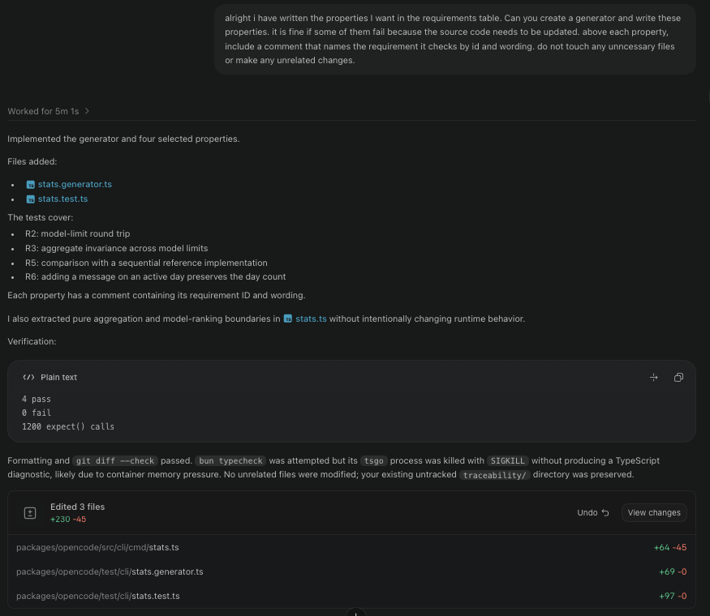

# Traceability: mishag

**Target feature:** Aggregation Statistics

Source Files:
- packages/opencode/src/cli/cmd/stats.ts
- packages/opencode/src/index.ts
- packages/opencode/src/session/session.ts
- packages/opencode/src/project/project.ts
- packages/opencode/src/cli/effect-cmd.ts
- packages/core/src/session/sql.ts

## Requirements

| ID | Interview evidence | Requirement | Acceptance Criteria | Changed in P4? | Property (kind) | Test | Mutants it Kills |
|---|---|---|---|---|---|---|---|
| R1 | C-12: “even though I deleted the session, I still sent that message, so that can't really be undone” S-6: ”...you still, like, actively send a message and use the model. Um, maybe they're gonna be like separate, like, deleted, like, sessions or something, but, like, to me, like, these numbers should always be there.” O-6: “the same stats that we saw before we deleted the session” | Deleting a session doesn’t remove historical token usage, cost, session count, and message cost from the stats. | The token usage, cost, session count, and message count remain the same in the statistics after deleting a session with at least one message sent. | No | | | |
| R2 | S-8: “Well, the top 3 of the top 5 should be the same as the top 3, um, like just looking at the top 3. I guess for the top 5, you also have the 4th one and the 5th one O-9: “I'm assuming, the first three outputted for the list of five will be the same as the ones that were listed for the list of three” | Increasing the number of displayed models must preserve the existing ranking and stats of previously displayed models. | Having used at least 5 distinct models, running the stats with –models 3 and –models 5 should produce the same top three models with the same stats. | No | Round-trip | Changing the model limit from 3 to 5 and back to 3 reproduces the original 3 displayed records exactly. | H1, H2 |
| R3 | S-10: “your usage across, like, all models, so that should always, like, stay the same” O-10: “No [the overview values should not change]” | Changing the models displayed should not change the overall aggregated stats. | Having used at least 5 distinct models, running the stats with the models flag set to 3 and the models flag set to 5 should produce the session counts, message counts, and overall token counts. | No | invariant | For any two model limits, all overview cost and token fields are identical. | |
| R4 | C-10: “I would say every message, though, because who knows how many tokens I'm using with one message” S-4: “[the stats should update] after every message.” O-3: “[the stats should update] after every message.” | The statistics feature must record newly sent messages and their associated token usage and cost before closing the session. | Given one terminal with a running session and another one with the latest stats, sending a message, and then getting the stats again on the 2nd terminal after receiving a reply, before closing the session should increment the message count, increase the token count, and increase the total cost. | No | | | |
| R5 | C-8: “I would absolutely not want the number of tokens I've used to be incorrect in any way” S-3: “I think the cost, like, affects the users the most” O-3: “token usage slash cost” | The stats feature must accurately report the total token usage and total cost stats. | Given a session with two messages that used 100 tokens and 200 tokens, and cost $0.03 and $0.08, the total tokens should increase by 300 tokens and the total cost should increase by $0.11 as a result of this session. | No | oracle | For any generated collection of sessions containing nonnegative usage fields, the aggregator agrees field-for-field with a simple reference implementation that sums those fields sequentially. | H3, H4 |
| R6 | C-8: “I would want to accurately know the number of days I've actually used the tool versus, like, how many days it's been since I started using it” | The stats feature must distinguish between the number of days OpenCode has been used and the number of days since the user started using it. | Given that the user starts using OpenCode and then goes back and uses it again 10 days later, with no usage in between, the number of days OpenCode has been used should be 2 days, but the number of days since the user started using it should be 10 days. | No | metamorphic | Adding another message on an already active day does not change the number of active days. | H5 |

Properties written or suggested by opencode or another AI tool: R2, R3, R5, R6

## Requirement changes

| ID | Original requirement (P3) | Revised requirement | Why it changed |
|---|---|---|---|

I kept all of my original requirements because they can all be build as written without any changes. All of the requirements are feasible, non-conflicting, and can be checked.

## Hand-written mutants
| ID | Requirement targeted | Change | Predicted Killer | Actual Result |
|---|---|---|---|---| 
| H1 | R2 | Change slice(0, modelLimit) to slice(0, modelLimit - 1) | R2 fails because limit 3 returns only two records, while the first three from limit 5 contain three. | Killed by R2: five tied models exposed the off-by-one limit. |
| H2 | R2 | Slice models before sorting them. | R2 fails when the top three among five models differ from the independently selected three models. | Killed by R2: the fifth model had one message and was incorrectly excluded before sorting. |
| H3 | R5 | Don't include the reasoning tokens of a session in stats.totalTokens.reasoning. | R5’s reference implementation includes reasoning tokens and detects the mismatch. | H3: Killed by R5: one session with one reasoning token was reported as zero. |
| H4 | R5 | Replace stats.totalCost += result.sessionCost with stats.totalCost = result.sessionCost | R5 fails because it detects that multiple sessions’ costs are not summed. | Killed by R5: two sessions with costs 10000 and 0 produced 0 instead of 10000. |
| H5 | R6 | Set active days to the number of activity timestamps instead of the number of distinct calendar dates. | R6 adds another message on the same day and detects the incorrect increase in active days. | Killed by R6: duplicating activity on one day produced two active days instead of one. |

## Stryker comparison
Mutation Score: 24.00%  
Which of your hand-written mutants did Stryker never generate? Why not?  
Stryker did not generate any of my handwritten mutants. The mutants generated by Stryker mainly changes existing operators, conditions, literals, and method calls, and did not generate mutants that required slightly larger structural changes, like my mutants. It generated some mutants that were related to my mutants such as replacing += with -= which was similar to H4 that replaced += with =, but didn't produce the exact same mutants.  

Which Stryker survivors would you never have thought of? Are any of them bugs a real developer might plausibly write?  
I would have never thought of swapping Math.min and Math.max for date boundaries, and didn't consider just entirely deleting parts of the code such as Stryker did for just entirely removing token sorting and removing model sorting. I thought of reordering lines to chang when the sorting is done, but wouldn't have thought of removing it entirely. I think swapping Math.min and Math.max for date boundaries and not including parts of the code such as sorting are both real bugs a developer might plausibly write, but some of the mutations such as adding booleans to integers are less plausible.  

What does each approach find that the other doesn't?  
Hand-written mutation testing targets realistic, requirement-specific mistakes such as off-by-one limits, incorrect operation order, lost accumulated values, and confusing timestamps with distinct dates. Stryker systematically explores many smaller implementation-level mutations that are easy to overlook, revealing that the properties do not cover date ranges, model aggregates, averages, or median calculations.  

### Equivalent mutants
1. results.length > 0 → true. 
The function returns early when results.length === 0, so this expression is reached only when results are nonempty. Therefore, both conditions always select the division branch and produce identical behavior.  

2. results.length > 0 → results.length >= 0. 
Although >= 0 is normally broader, the earlier empty-results return guarantees that results.length > 0 at this line. Both the original and mutated conditions are therefore always true for every reachable execution.  

3. sessionTotalTokens.length === 0 → false. 
Every result adds one entry to sessionTotalTokens, and empty results return before the median calculation. Consequently, the array cannot be empty when this condition is evaluated, so the original condition is already always false.  

4. modelLimit === Infinity ? sortedModels : ... → always use slice(0, modelLimit). 
When modelLimit is Infinity, sortedModels.slice(0, Infinity) returns every element in the same order as sortedModels. The array is created locally, so returning an equivalent shallow copy instead of the local array produces no observable difference.  

Stryker Reported Final Mutation Score: 94.67%. 
Final Mutation Score Excluding Equivalent Mutants: 100%. 

## Agent failure case
Agent Transcript:   
.  

Mutant it let Survive:    
Stryker's mutant that completely removed sorting survived.   

Why was the property too weak:     
The property was too weak because the property only checked consistency between repeated calls to the same faulty implementation. It didn't check that the correct top three models were returned, just that the top three were consistent among calls. This meant that if the bottom three models were returned as the top three, and then as the top three of the top 5, my property wouldn't catch the mutant.    

The strengthened version, and evidence that it kills the mutant:   
The strengthened version used an oracle, so the faulty implementation wasn't being compared against another faulty implementation, but a correct one. This allowed it to not only check for consistent, but also check that the models being returned were correct models. Evidence that the mutant was killed is that the score improved from 24.00% to 94.67% with the only surviving mutants having been proved to be equivalent mutants.   